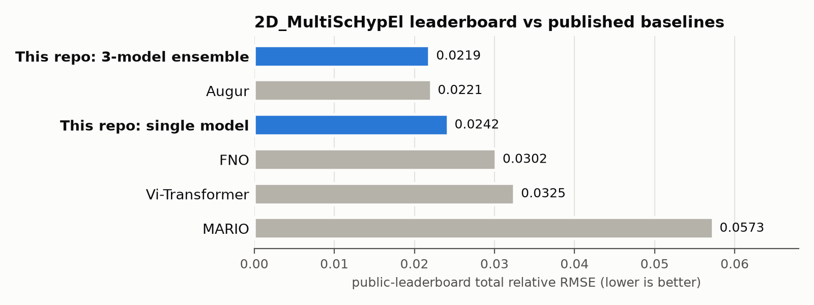
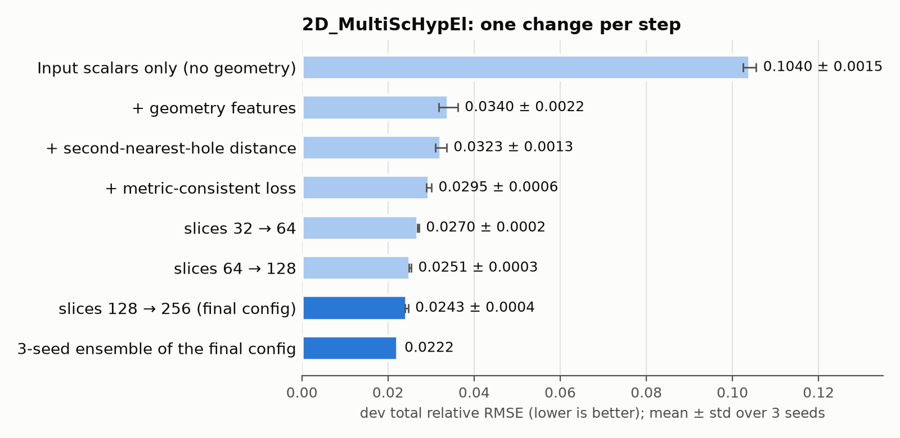
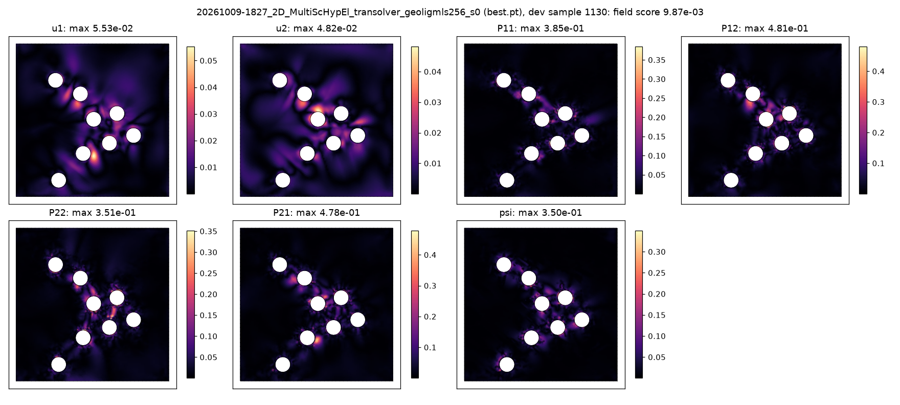

# Neural surrogates for nonlinear solid mechanics on the PLAID benchmarks

Transformer-based neural operators
([Transolver](https://arxiv.org/abs/2402.02366), via [NVIDIA
PhysicsNeMo](https://github.com/NVIDIA/physicsnemo)) that predict full-field
solutions of nonlinear solid-mechanics problems directly on unstructured
finite-element meshes. They are trained and evaluated on Safran's public
[PLAID](https://arxiv.org/abs/2505.02974) benchmarks.

> **Unofficial personal project.** A side project, separate from my PhD
> research. It is not affiliated with or endorsed by Brown University, the Brown
> School of Engineering, my PhD advisor or research group, Safran, the PLAID
> authors, or NVIDIA.

**Main result.** On `2D_MultiScHypEl`, a finite-strain hyperelastic RVE whose
5–8 voids change from sample to sample, a 3-model ensemble scores **0.0219**
total relative RMSE on the public leaderboard (as of 2026-10-30), lower than
every published baseline on that board. A single model scores **0.0242** (5-fold
CV 0.0248 ± 0.0002).

## Results

Public leaderboards as of 2026-10-30, total relative RMSE (lower is better; the
mean of the 8 per-output errors,
[definition](docs/methods.md#2-metric-and-validation)). The baselines are the
published baseline entries on the same boards, scored on the same public test
subset. This repository's entries are `samikm26` on
[2D_MultiScHypEl](https://huggingface.co/spaces/PLAIDcompetitions/2DMultiscaleHyperelasticityBenchmark)
and `samikm` on
[Tensile2d](https://huggingface.co/spaces/PLAIDcompetitions/Tensile2dBenchmark).
A board shows only each account's best entry, so the single-model 2D score
(0.0242, submitted 2026-10-17) is not listed there.

| | **2D_MultiScHypEl** | **Tensile2d** |
|---|---|---|
| **This repo, 3-model ensemble** | **0.0219** | — |
| **This repo, single model** | **0.0242** | **0.0054** |
| Augur | 0.0221 | 0.0066 |
| FNO | 0.0302 | 0.0123 |
| Vi-Transformer | 0.0325 | 0.0116 |
| MARIO | 0.0573 | 0.0038 |
| MeshGraphNet | — | 0.0080 |
| MMGP | — (needs a fixed topology) | 0.0026 |

The boards also list community entries, some of which score better: the
ensemble ranks 13th on 2D_MultiScHypEl and the single model 18th on Tensile2d.

<p align="center">
  
</p>

Local estimates predicted the leaderboard well: for 2D_MultiScHypEl, the single
model's 5-fold CV gave 0.0248 ± 0.0002 (board 0.0242), and the corresponding
ensemble of the three dev-protocol models gave 0.0222 (board 0.0219).

Per output, 2D_MultiScHypEl ensemble (board): u1 0.0057 · u2 0.0057 · P11 0.0255
· P12 0.0370 · P22 0.0259 · P21 0.0365 · psi 0.0269 · effective_energy 0.0117.
The shear stresses P12/P21 are the hardest outputs; their errors concentrate in
the narrow ligaments between neighbouring holes.

## What mattered (2D_MultiScHypEl)

<p align="center">
  
</p>

Each step changes one thing relative to the row above. Dev split: 76 samples.
Mean ± std over 3 seeds unless marked. A step counts only if it beats its parent
by more than twice the larger seed spread (and at least 0.001).

| Step | Config | Dev total_error |
|---|---|---|
| Input scalars only (no geometry) | `2dmultischypel_transolver_base` | 0.1040 ± 0.0015 |
| + geometry: boundary-category one-hot, distances to outer and hole boundaries | `…_geo` | 0.0340 ± 0.0022 |
| + distance to the second-nearest hole (ligaments) | `…_geolig` | 0.0323 ± 0.0013 |
| + metric-consistent loss | `…_geoligml` | 0.0295 ± 0.0006 |
| physics-attention slices 32 → 64 | `…_geoligmls64` | 0.0270 ± 0.0002 |
| slices 64 → 128 | `…_geoligmls128` | 0.0251 ± 0.0003 (CV 0.0256 ± 0.0006) |
| **slices 128 → 256 (final)** | **`…_geoligmls256`** | **0.0243 ± 0.0004 (CV 0.0248 ± 0.0002)** |
| **3-seed ensemble of the final config** | `ensemble.py` | **0.0222** |

What did not help, all relative to the final config unless noted:

| Change | Dev total_error | Why |
|---|---|---|
| width 128 → 256 (vs slices 64) | 0.0275 ± 0.0001 | fits the training set better, overfits |
| 400 epochs instead of 200 (1 seed) | best 0.0244, last 0.0252 | training error keeps falling, dev doesn't |
| 8 layers instead of 4 (1 seed) | best 0.0243, last 0.0249 | same |
| Transolver++ (1 seed) | 0.0251 | worse; also non-deterministic at inference in PhysicsNeMo 2.1.1 |

**Reading.** Geometry encoding is most of the gain: Transolver does not see mesh
connectivity, so it only knows where the traction-free holes are through input
features. After that, the model is **limited by generalization from ~700
training meshes, not by capacity**: more depth or epochs lower the training
error without lowering the validation error, while averaging three models helps
every output. The natural next steps are inputs that add information (e.g. the
direction to the nearest hole) and symmetry-based data augmentation (mirrored
and rotated RVEs with C, u and P transformed accordingly). Neither is
implemented here.

<p align="center">
  
</p>
<p align="center"><sub>
  Error of the final configuration (one seed) on its hardest dev sample:
  |prediction − reference| / max|reference| per output. Displacement errors are
  smooth; stress and energy errors concentrate in the ligaments between
  neighbouring holes.
</sub></p>

## Method in brief

- **Data.** Each dataset is converted once into a cache that keeps the
  benchmark's split and node order; only the converter imports PLAID.
- **Metric.** Re-implemented exactly and checked against the leaderboard's
  published scoring code (identical to a relative 1e-12).
- **Validation.** Seeded, stratified dev split (number of holes × load
  magnitude); 3 seeds per configuration; 5-fold cross-validation for the final
  candidates; leaderboard scores are never used to choose anything.
- **Model.** PhysicsNeMo Transolver (4 layers, width 128, 256 slices, ≈0.81M
  parameters), whole meshes per step, node coordinates as the embedding,
  geometric features as inputs.
- **Loss.** A metric-consistent loss: per-sample normalization by max |f|, with
  fields weighted by their running error, so training follows the scored metric.
- **Scalars.** `effective_energy` is the RVE-area average of the predicted
  strain-energy density. Tensile2d's three scalars are exact nodal identities of
  the predicted fields.
- **Final model.** Retrained on all 764 training samples with the number of
  optimizer updates of the validated runs, three seeds, averaged.

Details: [`docs/methods.md`](docs/methods.md). Data audit and full ablation
notes: [DSG-002](docs/design/DSG-002-data-2d-multischypel.md). All documents:
[`docs/`](docs/README.md).

## Reproduce

**Tested on** Linux x86_64 with Python 3.12 and one NVIDIA GPU (an RTX A5000;
peak memory ≈ 1 GB), with about 2 GB of disk for the data. Times below are for
that setup.

**Other platforms (untested):**

- *Windows:* use WSL2. Native Windows isn't supported yet, because the run log
  uses POSIX file locking.
- *macOS:* training and prediction only need the converted data cache, so they
  can run on CPU or Apple GPUs. Data conversion needs `pyplaid`, whose `pycgns`
  dependency has no Apple-Silicon wheel, so convert on Linux and copy the cache
  over.
- Off Linux, `requirements.lock` (Linux CUDA wheels) won't install. Install the
  pinned versions from [DSG-001](docs/design/DSG-001-environment.md) instead.

### 1. Environment

```bash
git clone https://github.com/samik314/neural-surrogates-plaid.git
cd neural-surrogates-plaid
mamba create -n plaid_env python=3.12 pip -y && mamba activate plaid_env
# exact package set: torch 2.14 cu126, PhysicsNeMo 2.1.1, pyplaid 0.1.15
pip install -r requirements.lock
pip install -e . --no-deps
pytest -q        # test suite, CPU, ~2 min (integration tests skip until the
                 # data is converted)
```

Two pins are deliberate: PhysicsNeMo 2.1.1, not 2.2.x, because of a dependency
conflict with `pyplaid` 0.1.15
([DEC-001](docs/decisions/DEC-001-physicsnemo-2.1.1.md)); and torch with
torchvision from the same CUDA index. Fixes for known installation problems:
[DSG-001](docs/design/DSG-001-environment.md).

Data and runs go to `./data/` and `./runs/` by default; set `PLAID_DATA_DIR`,
`PLAID_RUNS_DIR` and `HF_HOME` to put them elsewhere
([`.env.example`](.env.example)).

### 2. Data

```bash
# ~0.4 GB download, ~0.6 GB cache
python -m plaid_surrogates.data.convert --dataset 2D_MultiScHypEl --processes 4
pytest -q tests/integration        # cache vs PLAID
```

The dev split and the 5 CV folds are committed in `data/splits/`. The code
checks them against the cache, so they are reused as they are, not regenerated.

### 3. Final model and submission

```bash
CFG=configs/2dmultischypel_transolver_geoligmls256.yaml

# (a) 3 seeds on the dev protocol: dev ≈ 0.024 each (~60 min per seed)
for s in 0 1 2; do
  python -m plaid_surrogates.train --config $CFG --seed $s
done

# (b) optional: 5-fold CV, ≈ 0.0248 ± 0.0002 on the last checkpoint
#     (~55 min per fold)
for k in 0 1 2 3 4; do
  python -m plaid_surrogates.train --config $CFG --seed 0 --fold $k
done

# (c) final retrain on all 764 training samples, 3 seeds, then predict the
#     test split (~60 min each)
for s in 0 1 2; do
  python -m plaid_surrogates.train --config $CFG --seed $s --full
  RUN=$(ls -td runs/*_geoligmls256_s${s}_full | head -1)
  python -m plaid_surrogates.predict --run "$RUN" --split test --checkpoint last
done

# (d) average the three into one submission file
python -m plaid_surrogates.ensemble --runs runs/*_geoligmls256_s[012]_full \
    --split test --checkpoint last
```

Each run writes a folder under `runs/` with its config, git commit, environment,
curves, metrics, checkpoints and predictions, and appends a line to
`experiments/LOG.md`. A submission folder contains
`prediction_2d_multischypel.pkl` and a `LOG_ROW.md` naming the leaderboard it
belongs to. Expect small run-to-run differences: GPU kernels are not
bit-deterministic.

The logs start empty in this repository. The runs behind the reported results
are summarized in [DSG-002](docs/design/DSG-002-data-2d-multischypel.md), and
each has its config in `configs/`.

Every row of the ablation tables can be rerun the same way with its config from
`configs/`. Tensile2d works the same way with `--dataset Tensile2d` and
`configs/tensile2d_transolver_base.yaml` (dev ≈ 0.0049, ~35 min).

### On a Slurm cluster

[`scripts/slurm/`](scripts/slurm/) has one job script per step: `setup_env.sh`,
`convert.sh`, `train.sh` (dev, `FOLD=k` or `FULL=1`, followed by its
predictions) and `ensemble.sh`. Each takes its settings from environment
variables, for example
`CONFIG=configs/2dmultischypel_transolver_geoligmls256.yaml SEED=1 FULL=1 sbatch
scripts/slurm/train.sh`. Adjust the `#SBATCH` partition and GPU lines, and the
environment activation in `_common.sh`, to your cluster.

## Repository layout

```
src/plaid_surrogates/
  data/          convert.py (the only module importing PLAID), cache, dataset,
                 splits, features, normalization, data audit, and the registry
                 of datasets and leaderboards
  models/        Transolver factory
  train.py       training: dev split, --fold k (CV) or --full (final retrain)
  predict.py     dev round trip and test submission files
  ensemble.py    equal-weight ensembles of runs
  losses.py      standardized MSE and the metric-consistent loss
  metrics.py     the benchmark metric
  scalars.py     scalar predictors
  identities.py  the physics identities behind them
  submission.py  validated submission writer
configs/         one YAML per configuration in the tables above
data/splits/     committed dev split and CV folds
docs/            methods.md, design notes, a decision record, figures
scripts/         Slurm job templates and the figure script
tests/           unit tests; tests/integration/ needs pyplaid and the cache
```

## Authorship

**Samik Mukhopadhyay** (samik_mukhopadhyay [at] brown [dot] edu), PhD student in
Solid Mechanics, School of Engineering, Brown University.

Most of the code, tests, and docs were written with an AI coding assistant
(Claude Code), under my direction and review.

## Licensing and credits

- **Code:** MIT ([`LICENSE`](LICENSE)).
- **Citing:** see [`CITATION.cff`](CITATION.cff), or use "Cite this repository"
  on GitHub.
- **Data:** the PLAID datasets are © Safran, licensed **CC-BY-SA-4.0**. This
  repository contains no raw or converted data and no predictions; download the
  data from Hugging Face with the commands above.
- **Figures:** `docs/figures/error_map_2d.png` shows model predictions on a
  PLAID sample and is shared under
  [CC-BY-SA-4.0](https://creativecommons.org/licenses/by-sa/4.0/); the other
  figures and their data are MIT. Details:
  [`docs/figures/LICENSE.md`](docs/figures/LICENSE.md).
- **PLAID:** F. Casenave et al., *PLAID: A Unified Data Model for Machine
  Learning on Heterogeneous Physics Simulations*,
  [arXiv:2505.02974](https://arxiv.org/abs/2505.02974); library
  [`PLAID-lib/plaid`](https://github.com/PLAID-lib/plaid); baselines
  [`PLAID-lib/plaid-benchmarks`](https://github.com/PLAID-lib/plaid-benchmarks);
  leaderboards
  [Tensile2d](https://huggingface.co/spaces/PLAIDcompetitions/Tensile2dBenchmark)
  and
  [2D_MultiScHypEl](https://huggingface.co/spaces/PLAIDcompetitions/2DMultiscaleHyperelasticityBenchmark).
- **NVIDIA PhysicsNeMo:**
  [github.com/NVIDIA/physicsnemo](https://github.com/NVIDIA/physicsnemo),
  Apache-2.0.
- **Transolver:** H. Wu et al., *Transolver: A Fast Transformer Solver for PDEs
  on General Geometries*, [arXiv:2402.02366](https://arxiv.org/abs/2402.02366).
